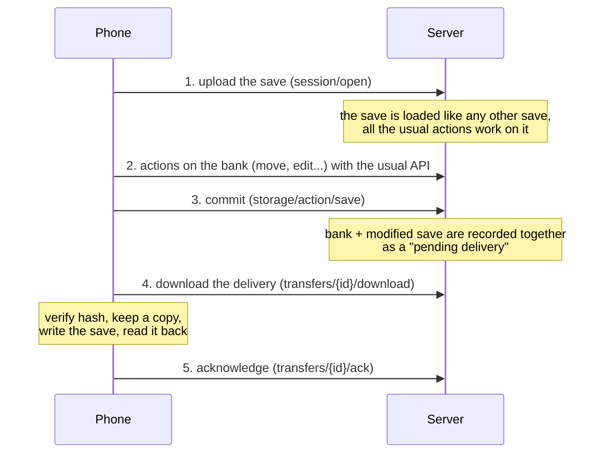

# PKVault - Remote bank

The Android app can use the bank of a PKVault server (typically the Docker image on a NAS), while keeping its own saves on the phone.
The local bank stays available: the user switches between the two in the settings.

For how to build and try it, see [remote-bank-testing.md](./remote-bank-testing.md).

## Principle: the save travels

The phone does not edit the server bank remotely, and the server never reads the phone files.
Instead, **the save travels**:

A Pokémon moved from the save to the bank is, after step 3, in the bank (server) and gone from the delivered save.
The only moment it exists nowhere but in the delivery is between steps 3 and 5, and the delivery is kept on the server until the ack.

## Why a Pokémon is never lost

| Risk | What prevents it |
| --- | --- |
| Connection lost while sending the save | The exact bytes sent are kept in the journal and re-sent as is; uploading again is idempotent. |
| Connection lost during the commit, answer never comes back | The transfer is marked *maybe committed* before the request leaves; it is resolved by listing the deliveries, never assumed to have failed. |
| Server stops during the commit | The bank and the delivery are written in the same database, committed by the one atomic step that already existed (the session DB replaces the main DB). Both happen, or neither. A backup taken before the commit is restored on any error. |
| Connection lost while downloading | The download is verified against its SHA-256 and only then stored; a corrupted one is never accepted. Downloading again is safe. |
| The game was played on the phone since the upload | Before writing, the phone save is compared with the one uploaded. If it differs nothing is written: it is a **conflict** the user settles (see below). |
| The app is killed in the middle of writing the save | Android writes (`"wt"`) truncate first and are not atomic. A copy of what was there is kept before the first write, the transfer stays in `WRITING`, and the next start writes it again from the stored delivery. |
| A write that "succeeds" but stores wrong content | The written save is read back and its hash compared before anything is acknowledged. |
| Acknowledgement lost | The ack is idempotent and repeated until it works. The server keeps the delivery until then. |
| Server restored from an older backup | The delivery becomes unknown to the server: the transfer goes to `CONFLICT` (`DELIVERY_GONE`) instead of writing anything. |
| Local bank editing a save being edited on the server | The local bank refuses to save a save with a transfer in progress. |

Nothing is ever deleted from the journal by the engine, except finished transfers older than 30 days (and never one with a warning, in conflict, paused or with a local reload to do).

## States of a transfer (on the device)

| State | Meaning | If interrupted |
| --- | --- | --- |
| `UPLOADING` | Sending the save | Sent again (idempotent) |
| `UPLOADED` | Open on the server, waiting for edits | Waits; no cost |
| `COMMIT_REQUESTED` | A commit was sent, a delivery may exist | Resolved by listing the deliveries |
| `COMMITTED_ON_SERVER` | The delivery exists, to download | Downloaded again |
| `DOWNLOADED` | Delivery stored and verified, device save not yet checked | Checked again |
| `WRITING` | Writing the device save (can be half written) | Written again from the stored delivery |
| `WRITTEN` | Written and read back, ack not sent | Ack sent again |
| `ACKED` | Done | - |
| `CLOSED` | Nothing to deliver (closed by the user, or the server refused the save) | - |
| `CONFLICT` | Needs a decision, nothing is written meanwhile | Waits |

A transfer which cannot move because of a network or server problem keeps its state, shows the reason (`lastError`) and goes on by itself when the server is reachable again: the status polled by the UI resumes it, as does the start of the app.

## Conflicts

| Reason | Meaning | Choices |
| --- | --- | --- |
| `DEVICE_SAVE_CHANGED` | The phone save is neither the uploaded one nor the delivered one (game played since) | Cancel the changes on the server; or replace the phone save (a copy of the current one is kept in the journal) |
| `DEVICE_SAVE_MISSING` | The save file is gone | Write the delivered save; or cancel on the server |
| `WRITE_FAILED` | The save could not be written after 3 attempts; the previous content was put back | Try again; or cancel on the server |
| `DELIVERY_GONE` | The server does not know the delivery (ex: its data was restored) | Forget it (there is nothing to write or cancel) |

*Cancel on the server* restores the backup taken just before the commit. It is refused (`ABORT_NOT_POSSIBLE`) if anything else was saved on the server since, since restoring would drop it; the delivery then stays and the other choices remain.

## Server side

- `RemoteTransferEntity` (table `RemoteTransfers`): the outbox. One row per delivery: hashes of the uploaded and delivered saves, the delivered bytes, the time of the backup, a commit sequence number, a state (`READY`, `ACKED`, `ABORTED`).
- `RemoteSaveService.RecordCommit` is called by `SessionService.PersistSession` before the database swap. Saves received from a device (folder `./remote-saves/{deviceId}/{saveId}/`) are not written to disk when committed: their bytes go to the delivery.
- `RemoteBankService` + `RemoteController` (`api/remote`):

| Route | |
| --- | --- |
| `GET ping` | Version and commit sequence |
| `POST session/open?deviceId&fileName` | Upload (multipart). `409 PENDING_DELIVERY` (with the transfer id) if a delivery of this save waits; `409 SAVE_ID_CONFLICT` if the save exists from another source |
| `POST session/close?deviceId&saveId` | Forget the uploaded copy |
| `GET transfers?deviceId` | Deliveries waiting for this device |
| `GET transfers/{id}/download` | Content, with `X-Hash-Original` and `X-Hash-New` |
| `POST transfers/{id}/ack?newHash` | Idempotent; `409 HASH_MISMATCH` if the hash differs |
| `POST transfers/{id}/abort` | Restore the backup before the commit, if nothing was saved since |

  The commit itself is the usual `POST api/storage/action/save`.
- An ack is written to the main database *and* the session database: the session one is a working copy replaced by the main one when the session restarts.
- Errors in a valid request but a wrong state are `409` with the headers `error-code` and `error-data`.
- `PKVAULT_API_TOKEN` makes the web backend require `Authorization: Bearer <token>` on every `/api` request (except the game spritesheets). `PKVAULT_TRANSFER_RETENTION_DAYS` (default 30) is how long a delivered content is kept after the ack.

## Device side (`PKVault.Core/remote-device`)

- `TransferCoordinator`: the state machine above, one step at a time for the whole app. Each step is recorded in the journal before the next one.
- `TransferJournal`: one JSON per transfer plus its contents, replaced atomically, in the private storage of the app.
- `HttpRemoteApiClient` / `RemoteHttpConnection`: the server API. Address and token are read at each request. A network problem is `RemoteUnreachableException` (pause and resume later); a server answer is `RemoteApiException`.
- `RemoteProxy`: in remote mode the UI keeps calling its usual API, and the requests are sent to the server instead of the local router. `api/device`, `api/settings` and `api/static-data` stay local. The commit request is wrapped: marked before it is sent, and the delivery looked for as soon as it ends. The `settings` of a server update are removed before they reach the UI. The bridge with the web view only carries text, so a binary answer is refused.
- `RemoteDeviceService` + `DeviceController` (`api/device`): status, configuration, mode, device saves, open / close, settle a conflict, sync.
- `PKVault.Mobile/Remote`: the only Android specific code: the preferences, the secure storage for the token, and the registration. The rest is in Core and tested without a phone.

Only the Android app registers the device side (`AddRemoteDevice()`); on the other hosts `api/device` answers that it is not available.

## Copying instead of moving

A Pokémon of a save can also be **copied** to the bank (button *Copy to bank*, on the storage page of the server copy of the save). The Pokémon stays in the save and the save is not modified at all, so there is nothing to deliver back: the commit stores the bank, and the transfer simply goes back to waiting (`UPLOADED`).

`CopyPkmToBankAction` creates plain bank Pokémon, not linked to the save. This differs from the *attached* move, which keeps a link to the save (orphan once the server session is closed) and changes the trade record counter of the save. The action never deletes, writes, flushes the party, changes the records of, or synchronizes with the save: a test checks the state of the save is unchanged, and fails if one of these is added.

It refuses, before creating anything, an egg, a shadow or locked Pokémon, a Pokémon already in the bank (same hash as the bank Pokémon), and the same Pokémon twice in the selection. The free slots (and the new box when the bank is full) come from `BankSlots`, shared with the move to the bank.

## Limits

- **One session on the server.** The server has a single working session: only one device edits at a time, and a device cannot open a save while the server has pending actions.
- **Same save from two places.** If the server already has a save with the same ID from its own saves or from another device, it refuses the upload (`SAVE_ID_CONFLICT`) instead of guessing which one to edit.
- **No download in remote mode** of a server file through the app (the bridge is text only). The save download button of the web UI works in a browser.
- **Plain http.** Android blocks plain http by default, and the token travels in clear on it. Use https (reverse proxy) or a VPN.
- **The Android part was not run on a device** when this was written (see the testing guide for what was verified).
